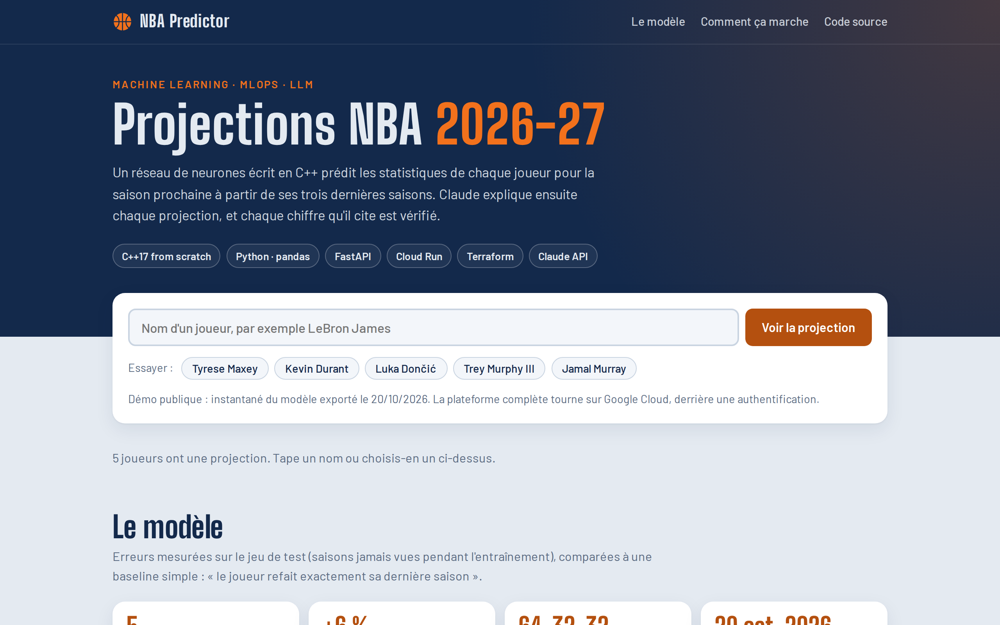
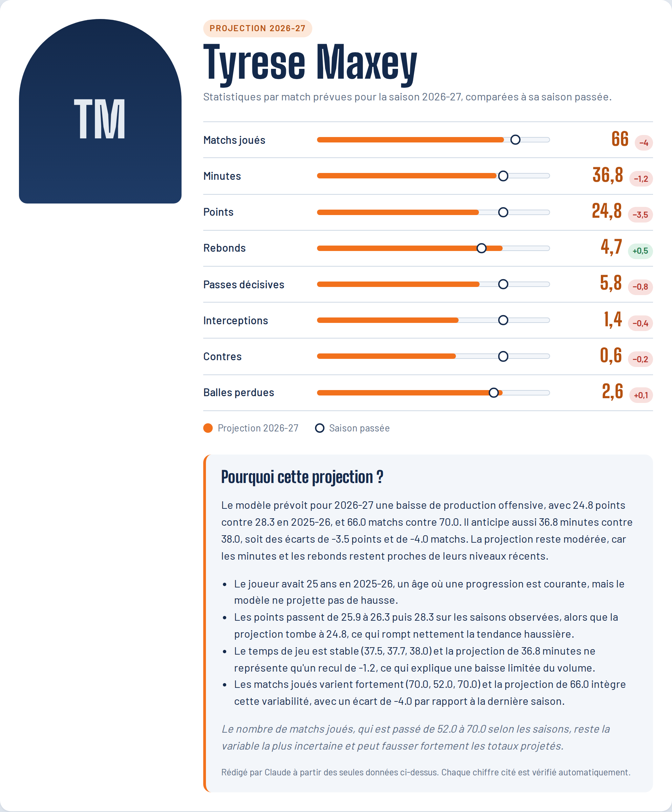
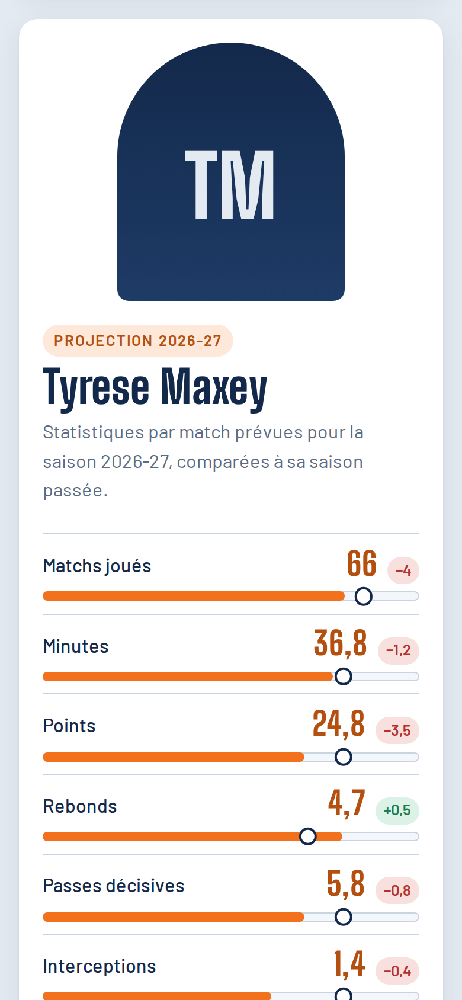
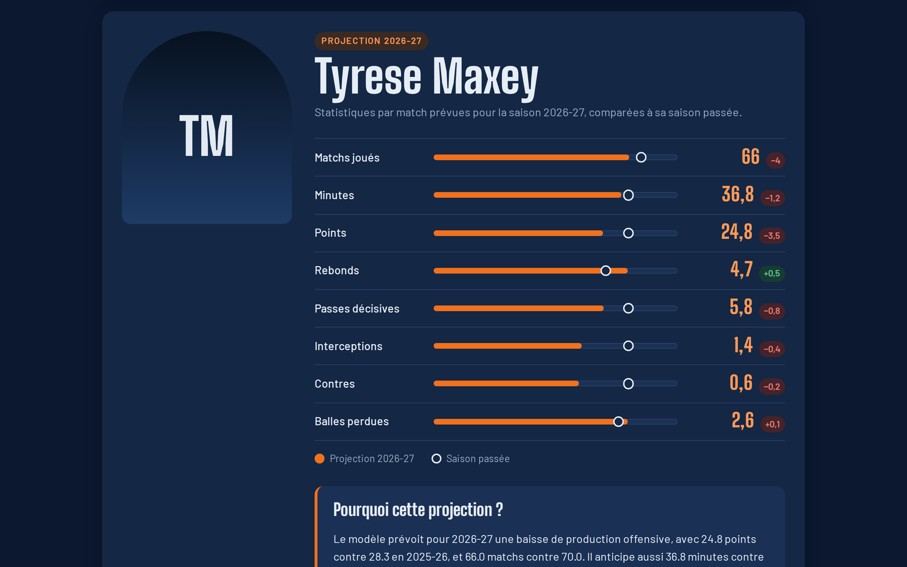
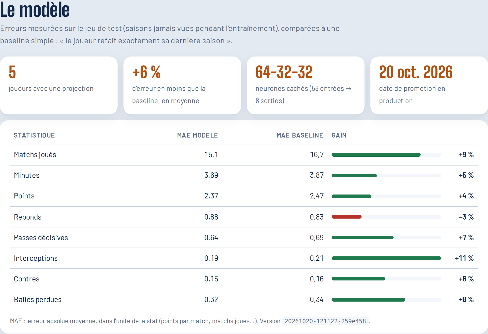
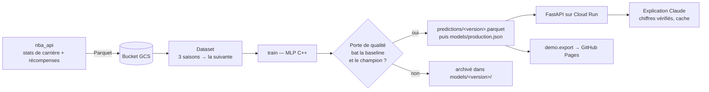

# NBA Predictor

[](https://github.com/loickballoy/NBA_Predictor/actions/workflows/ci.yml)
· **[Démo en ligne](https://loickballoy.github.io/NBA_Predictor/)** · [English version](README.md)

Ce projet prédit les statistiques par match de la saison prochaine (points, rebonds, passes, minutes, matchs joués…) pour chaque joueur NBA en activité, à partir de ses trois dernières saisons. Le modèle est un petit réseau de neurones que j'ai écrit en C++, sans librairie de ML. Il est réentraîné chaque semaine sur Google Cloud et ne passe en production que s'il fait mieux que le modèle déjà en place. Chaque projection est accompagnée d'une courte explication rédigée par Claude. Avant affichage, chaque chiffre qu'elle cite est vérifié dans les données.



## Pourquoi ce projet

Je voulais un projet qui aille de la donnée brute jusqu'à quelque chose d'utilisable, en maîtrisant chaque couche :

- **Un modèle écrit à la main.** Propagation avant, rétropropagation par SGD, conservation de la meilleure epoch sur la validation, normalisation des features, sauvegarde et chargement binaires : tout est dans `model/`, en C++17 avec uniquement la bibliothèque standard. Ni PyTorch, ni scikit-learn.
- **Un entraînement automatisé, avec une porte de qualité.** Un Cloud Run Job réentraîne le modèle, puis le compare au modèle en production sur la même validation. Il n'est promu que s'il bat à la fois la baseline « le joueur refait sa dernière saison » et le champion actuel. Les modèles refusés sont archivés aussi, ce qui permet de savoir pourquoi chacun a été écarté.
- **Un LLM sous contrôle.** Claude ne reçoit que des nombres calculés par le pipeline. Sa réponse doit respecter un schéma Pydantic. Si le texte contient un nombre absent des données, la réponse est rejetée. Après deux échecs, l'API bascule sur un résumé généré sans IA. Les explications valides sont mises en cache par version du modèle, donc chacune n'est payée qu'une fois.
- **Une infrastructure en code.** Toute la partie GCP est dans `infra/` et se monte avec `terraform apply` : bucket, Artifact Registry, job et service Cloud Run, Scheduler, IAM au moindre privilège avec conditions, Secret Manager et IAP.

## Captures d'écran

| Fiche joueur | Mobile | Mode sombre |
|---|---|---|
|  |  |  |

Les métriques du modèle, telles qu'affichées sur la démo :



## Fonctionnement



1. **Collecte.** `collector/fetch_raw.py` récupère les stats de carrière et les récompenses de tous les joueurs via `nba_api`, avec relances et backoff.
2. **Dataset.** `collector/build_dataset.py` construit des fenêtres de trois saisons consécutives (19 features chacune, plus l'âge) et prend la saison suivante comme cible. Le découpage est temporel : les cibles avant 2020 servent à l'entraînement, 2020-2022 à la validation et 2023 et après au test.
3. **Entraînement et porte de qualité.** `pipeline/job.py` lance le binaire C++ `train`. Il évalue ensuite le candidat et le champion sur la même validation (`pipeline/gate.py`) et écrit la décision dans `decision.json`. En cas de promotion, les prédictions sont publiées avant le pointeur `production.json`. L'écriture de ce pointeur est conditionnée à sa génération, si bien que deux jobs simultanés ne peuvent pas s'écraser.
4. **Service.** `api/main.py` lit le modèle en production et prend en compte une nouvelle version en cinq minutes au plus, sans redéploiement. `api/explain.py` appelle Claude et vérifie sa réponse.

Plus de détails dans [docs/ARCHITECTURE.md](docs/ARCHITECTURE.md).

## Résultats

Le tableau donne la MAE sur les saisons de test, comparée à la baseline « le joueur refait exactement sa dernière saison ». Plus la MAE est basse, mieux c'est. Le gain indique la part d'erreur que le modèle retire par rapport à la baseline.

<!-- Remplacer par le tableau affiché à la fin de `python -m demo.export` -->
| Stat | MAE modèle | MAE baseline | Gain |
|---|---:|---:|---:|
| Points | — | — | — |
| Rebonds | — | — | — |
| Passes | — | — | — |
| Minutes | — | — | — |
| Matchs joués | — | — | — |

La page de démo affiche les mêmes chiffres pour le modèle actuellement en ligne.

## Lancer en local

Il faut Python 3.12, g++ et make.

```bash
make -C model && make -C model test          # binaires C++ dans model/bin/
pip install -r requirements.txt

python -m collector fetch                      # long : environ 5 000 joueurs, débit limité
python -m collector build                      # → collector/data/processed/*.csv
```

Tout le pipeline d'entraînement peut aussi tourner sur un dossier local qui imite le bucket :

```bash
mkdir -p /tmp/bucket/data/raw && cp -r collector/data/raw/* /tmp/bucket/data/raw/
STORAGE_URI=file:///tmp/bucket TRAIN_BIN=model/bin/train PREDICT_BIN=model/bin/predict \
  python -m pipeline.job

STORAGE_URI=file:///tmp/bucket uvicorn api.main:app --port 8080   # http://localhost:8080
```

Sans `ANTHROPIC_API_KEY`, les explications utilisent le résumé sans IA. Avec la clé, il faut aussi installer le SDK (`pip install anthropic`).

### Tests

```bash
pytest -q
```

Les tests de l'API et du pipeline font tourner le vrai job de bout en bout sur des joueurs synthétiques. Il faut donc compiler les binaires C++ avant de les lancer. La CI fait la même chose à chaque push.

## Mettre à jour la démo

Le site GitHub Pages est un instantané statique, composé de `docs/index.html` et `docs/data.json`. Le consulter n'appelle jamais l'API : il ne coûte rien et reste en ligne même quand le projet GCP est éteint.

```bash
STORAGE_URI=gs://<bucket> ANTHROPIC_API_KEY=... python -m demo.export --out docs --limit 200
pip install playwright && python -m demo.screenshots   # régénère docs/screenshots/
git add docs && git commit -m "Mise à jour de la démo" && git push
```

Pages est configuré en *Deploy from a branch → `main` / `docs`*.

## Organisation du dépôt

```
collector/   téléchargement des données (nba_api) et construction du dataset
model/       réseau de neurones en C++ : bibliothèque, binaires train / predict, tests
pipeline/    job d'entraînement, porte de qualité, stockage (GCS ou local)
api/         service FastAPI, explications Claude, page web (api/static)
demo/        export statique pour GitHub Pages et script de captures
infra/       Terraform pour toute l'infrastructure GCP
tests/       suite pytest
docs/        site publié + notes d'architecture
```

## Limites

- Le modèle ne voit que les statistiques de match. Il ne sait rien des blessures, des transferts ni des changements de rôle, ce qui explique la plupart de ses grosses erreurs.
- Il faut trois saisons consécutives pour obtenir une projection : les rookies et les joueurs de deuxième année ne sont pas couverts.
- Le nombre de matchs joués est la cible la plus difficile, parce qu'il dépend surtout des blessures.
- L'API de production est protégée par Identity-Aware Proxy. C'est pour cette raison que la démo publique est un export statique.
