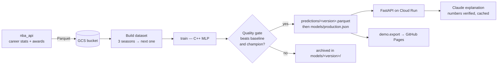

# NBA Predictor

[](https://github.com/loickballoy/NBA_Predictor/actions/workflows/ci.yml)
· **[Live demo](https://loickballoy.github.io/NBA_Predictor/)** · [Version française](README.fr.md)

Predicts next season's per-game stats for every active NBA player (points, rebounds, assists, minutes, games played…) from their last three seasons. The model is a small neural network I wrote in C++ without any ML library. It's retrained every week on Google Cloud and only goes to production if it beats the current one. Each projection comes with a short explanation written by Claude, and any number Claude cites is checked against the data before it's shown.


## Why I built it

I wanted one project that goes all the way from raw data to something people can actually use, and where I understand every layer:

- **The model is hand-written.** Forward pass, backpropagation with SGD, keeping the best epoch on validation, feature scaling and binary save/load are all in `model/` (C++17, standard library only). No PyTorch, no scikit-learn.
- **Training is automated, with a quality gate.** A Cloud Run Job retrains the model and compares it against the production model on the same validation set. The new model is promoted only if it beats both the "repeat last season" baseline and the current champion. Rejected models are archived too, so you can always see why one was turned down.
- **The LLM is kept on a short leash.** Claude only sees numbers computed by the pipeline. Its answer has to match a Pydantic schema, and any number in the text that isn't in the input gets the response rejected. After two failed attempts, the API falls back to a template summary. Valid explanations are cached per model version, so each one is paid for once.
- **Infrastructure as code.** Everything on GCP (bucket, Artifact Registry, Cloud Run job and service, Scheduler, IAM with least-privilege conditions, Secret Manager, IAP) is in `infra/` and comes up with `terraform apply`.

## Screenshots

| Player view | Mobile | Dark mode |
|---|---|---|
|  |  |  |

Model metrics as shown on the demo page:


## How it works



1. **Collect.** `collector/fetch_raw.py` pulls career stats and awards for every player through `nba_api`, with retries and backoff.
2. **Dataset.** `collector/build_dataset.py` builds windows of three consecutive seasons (19 features each, plus age) and uses the following season as the target. The split is by time: targets before 2020 for training, 2020–2022 for validation, 2023 onwards for test.
3. **Train and gate.** `pipeline/job.py` runs the C++ `train` binary, scores the candidate and the current champion on the same validation set (`pipeline/gate.py`) and writes the decision to `decision.json`. On promotion, predictions are uploaded before the `production.json` pointer, and the pointer write uses a generation precondition, so two concurrent jobs can't overwrite each other.
4. **Serve.** `api/main.py` reads whatever is in production and picks up a new version within five minutes, without a redeploy. `api/explain.py` calls Claude and verifies the answer.

More detail in [docs/ARCHITECTURE.md](docs/ARCHITECTURE.md).

## Results

MAE on the test seasons, compared with the baseline "the player repeats last season exactly". Lower MAE is better; the gain is how much error the model removes compared with the baseline.

<!-- Replace with the table printed at the end of `python -m demo.export` -->
| Stat | Model MAE | Baseline MAE | Gain |
|---|---:|---:|---:|
| Points | — | — | — |
| Rebounds | — | — | — |
| Assists | — | — | — |
| Minutes | — | — | — |
| Games played | — | — | — |

The demo page shows the same numbers for the model that's currently live.

## Running it locally

You need Python 3.12, g++ and make.

```bash
make -C model && make -C model test          # C++ binaries in model/bin/
pip install -r requirements.txt

python -m collector fetch                      # takes a while: ~5k players, rate-limited
python -m collector build                      # → collector/data/processed/*.csv
```

The whole training pipeline also runs against a local folder that mimics the bucket:

```bash
mkdir -p /tmp/bucket/data/raw && cp -r collector/data/raw/* /tmp/bucket/data/raw/
STORAGE_URI=file:///tmp/bucket TRAIN_BIN=model/bin/train PREDICT_BIN=model/bin/predict \
  python -m pipeline.job

STORAGE_URI=file:///tmp/bucket uvicorn api.main:app --port 8080   # http://localhost:8080
```

Explanations use the template fallback unless `ANTHROPIC_API_KEY` is set (`pip install anthropic`).

### Tests

```bash
pytest -q
```

The API and pipeline tests run the real job end to end on synthetic players, so they need the C++ binaries to be compiled first. CI does the same on every push.

## Updating the demo

The GitHub Pages site is a static snapshot: `docs/index.html` plus `docs/data.json`. Visiting it never calls the API, so it costs nothing and stays up even when the GCP project is turned off.

```bash
STORAGE_URI=gs://<bucket> ANTHROPIC_API_KEY=... python -m demo.export --out docs --limit 200
pip install playwright && python -m demo.screenshots   # refreshes docs/screenshots/
git add docs && git commit -m "Update demo" && git push
```

Pages is set to *Deploy from a branch → `main` / `docs`*.

## Repository layout

```
collector/   data download (nba_api) and dataset construction
model/       neural network in C++: library, train / predict binaries, tests
pipeline/    training job, quality gate, storage abstraction (GCS or local)
api/         FastAPI service, Claude explanations, web page (api/static)
demo/        static export for GitHub Pages and screenshot script
infra/       Terraform for the whole GCP setup
tests/       pytest suite
docs/        published site + architecture notes
```

## Limits

- The model only sees box-score stats. It knows nothing about injuries, trades or role changes, which explains most of its big misses.
- Players need three consecutive seasons to get a projection, so rookies and second-year players aren't covered.
- Games played is the hardest target, and it's mostly driven by injuries.
- The live API sits behind Identity-Aware Proxy, which is why the public demo is a static export.
