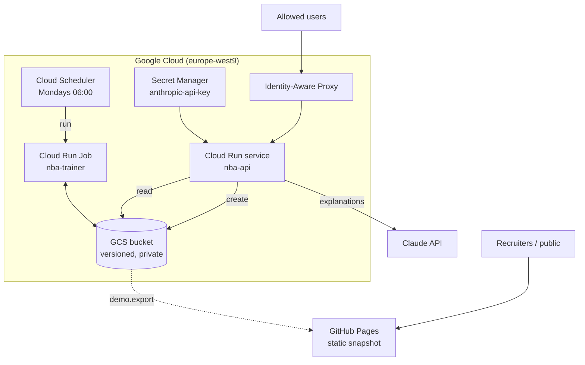

# Architecture

This is the longer version of the "How it works" section in the [README](../README.md). It follows the data from the NBA stats API to the page in your browser.

## Overview



The bucket is the only shared state. The job writes to it, the API reads from it, and the two never talk to each other directly.

```
data/raw/career_stats/*.parquet     raw nba_api data, one file per player
data/raw/awards/*.parquet
models/<version>/                    model.bin, scalers.json, metrics.json, decision.json
models/production.json               pointer to the version in production
predictions/<version>.parquet        next-season predictions + the 3 input seasons
explanations/<version>/<id>.json     cached Claude explanations
```

A version name looks like `20261019-060000-abc1234`: UTC timestamp, then the git commit of the image that trained it.

## 1. Data

`collector/fetch_raw.py` loops over every player known to `nba_api` and saves career stats and awards as one Parquet file per player. Calls are spaced out (0.6 s) and retried with exponential backoff and jitter, because stats.nba.com is quick to rate-limit. Files that already exist are skipped, so a crashed run picks up where it stopped.

`collector/clean.py` turns that into one row per player and season. When a player is traded mid-season, nba_api returns one row per team plus a `TOT` row; only the `TOT` row is kept. Award counts are joined on, and totals are converted to per-game values.

`collector/build_dataset.py` builds the training examples:

- **Input:** three consecutive seasons `s1, s2, s3`, with 19 features per season (games, starts, per-game box score, shooting percentages, award count), plus age in the last season.
- **Target:** the season right after, with 8 stats: games played, minutes, points, rebounds, assists, steals, blocks and turnovers.
- **Split:** done by the target season rather than at random. Targets before 2020 go to training, 2020–2022 to validation and 2023 onwards to test. A random split would leak a player's future into training.
- **Inference set:** players whose most recent season is the latest one in the data. Their target season is the next one.

All splits are checked before anything is written, so a failed build can't leave old and new CSVs mixed together.

## 2. Model (C++)

`model/` is a small library plus four binaries:

| Binary | Role |
|---|---|
| `train` | fit scalers on train, train the network, write `model.bin`, `scalers.json`, `metrics.json` |
| `predict` | load a model and write predictions for a CSV (with `_true`/`_last` columns when available) |
| `test_model` | unit tests: XOR convergence, save/load round trip |
| `xor` | sanity check |

The network is a fully connected MLP: tanh on the hidden layers, linear output, 64-32-32 hidden units by default. It's trained with per-sample SGD on standardised inputs and targets. After each epoch it measures MSE on the validation set and keeps the weights from the best epoch. The scalers are fitted on the training set only.

`metrics.json` stores MAE per target on validation and test, the baseline MAE ("repeat last season") and the gain over that baseline. The test set appears only in this report and is never used to make a decision.

## 3. Training job and quality gate

`pipeline/job.py` runs as a Cloud Run Job. Every step logs one JSON line, which Cloud Logging reads as a structured entry.

1. Download `data/raw/` from the bucket.
2. Build the dataset (same code as the collector).
3. Train a candidate with the `train` binary.
4. Score the candidate **and the current production model on the same validation set**. Comparing against the score the champion had when it was trained would be wrong, because the validation set changes when new seasons come in. If the champion can't read the current features anymore, it counts as having no champion.
5. Run the quality gate (`pipeline/gate.py`). The score is the average over targets of `MAE_model / MAE_baseline`, so below 1 means better than the baseline. The candidate is promoted only if its score is below 1 **and** below the champion's score (optionally by a minimum margin).
6. Always upload `models/<version>/`, including `decision.json` with the reason, even when the candidate is rejected.
7. On promotion, upload `predictions/<version>.parquet` **first**, then update `models/production.json`. That way the pointer never names a version that has no predictions. On GCS, the pointer write uses `if_generation_match`: if another job promoted something in the meantime, the write fails instead of silently overwriting it.

Because `pipeline/storage.py` has a local `file://` implementation with the same interface, the whole job runs in the test suite without GCP.

## 4. API

`api/main.py` (FastAPI):

| Endpoint | |
|---|---|
| `GET /health` | liveness, doesn't touch the bucket |
| `GET /model` | version, promotion date, architecture, test metrics |
| `GET /players` | players with a prediction |
| `GET /players/{id}/prediction` | projected stats and last season's stats |
| `GET /players/{id}/explain` | Claude's explanation |
| `GET /` | the web page |

`api/store.py` re-reads `production.json` at most every 5 minutes and downloads the predictions again only when the version changes. A promotion therefore goes live without a redeploy. Every request logs its route, status, latency and the model version it served.

### Explanations

`api/explain.py` has guardrails at four levels:

1. Claude only receives facts built by `build_facts()`: the three input seasons, the projection and the precomputed differences. It has no other data to draw on.
2. The answer has to parse into the `Explanation` Pydantic model (`resume`, 2 to 4 `facteurs`, `prudence`).
3. Every number found in the text has to exist in the facts, within rounding. If one doesn't, the answer is rejected and Claude gets a second try with the reason.
4. After two failures, a template explanation built from the same facts is returned instead.

Each call logs input/output tokens and an estimated cost in euros. Valid explanations are written to `explanations/<version>/<id>.json` with create-only permission, so they're never paid for twice and never overwritten.

## 5. Infrastructure (Terraform)

Everything is in `infra/`:

- **Bucket:** versioned, public access blocked, uniform IAM. Overwritten versions are kept 30 days.
- **Service accounts, one per component, with IAM conditions on object prefixes:**
  - the trainer reads `data/`, reads and writes `models/`, and can only *create* in `predictions/`;
  - the API reads `models/` and `predictions/`, and can only *create* in `explanations/`;
  - the scheduler can only start the job.
- **Cloud Run Job:** 1 CPU (the C++ is single-threaded) and 2 GiB, no automatic retry.
- **Cloud Run service:** scales from 0 to 2 instances, CPU billed only during requests, behind IAP with an explicit user list.
- **Secret Manager:** Terraform creates the secret but not its value. The key is added by hand with `gcloud`, so it never ends up in the repo or in the Terraform state.
- **Cloud Scheduler:** weekly, paused by default, turned on during the season.

## 6. Public demo

The API sits behind IAP, so recruiters can't open it. `demo/export.py` takes a snapshot instead:

- it reads the production model the same way the API does;
- it generates or loads the explanation for each player;
- it writes everything into `docs/data.json`, next to a copy of `api/static/index.html` with a `<meta name="nba-data">` tag.

When that tag is present, the page reads the JSON file instead of calling the API. It's the same page and the same rendering code, with no backend: no cost and nothing to attack, and the demo keeps working when the GCP project is shut down.

`demo/screenshots.py` serves `docs/` locally and takes the README screenshots with Playwright.
